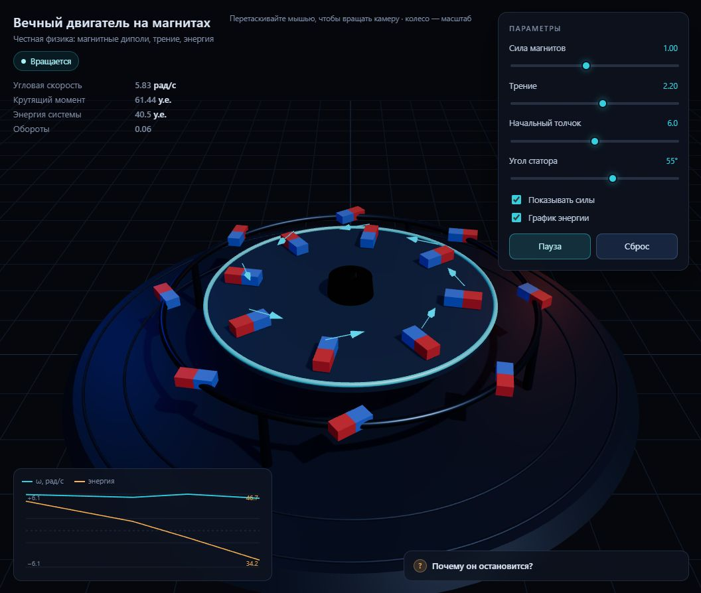

# Вечный двигатель на магнитах — 3D-визуализация

Интерактивная сцена на Three.js, которая показывает, как «вечный двигатель на магнитах»
вёл бы себя по-настоящему: магнитные диполи, трение и сохранение энергии. Ротор
раскручивается, колеблется и останавливается в положении равновесия.

**Живая страница:** <https://mypoddomenjm.mooo.com/magnet/>



## Что внутри

- Один `index.html` — без сборки и зависимостей в репозитории.
- Three.js 0.169 загружается с CDN (нужен интернет).
- Физика: поле магнитных диполей, момент `τ = −dU/dθ`, интегратор «скорость-Верле»
  с шагом 1/480 с.
- При трении 0 энергия сохраняется: ротор вращается сколь угодно долго, но не
  разгоняется. Это принципиальная позиция проекта — вечного движения нет.

## Локальный запуск

```bash
python -m http.server 8000
```

Открыть <http://localhost:8000>. Прямое открытие `file://` может не сработать из-за
CORS у ES-модулей — на этот случай в странице есть подсказка.

## Управление

- Сила магнитов, трение, начальный толчок, угол статора.
- Пауза/продолжить и сброс.
- График угловой скорости и полной энергии.
- Переключатели стрелок сил и графика.

## Деплой

Push в `main` запускает GitHub Actions (`.github/workflows/deploy.yml`), который
копирует `index.html` на сервер в `/var/www/magnet/`.

Ручной вариант с локальной машины — `./deploy/deploy.ps1` (использует root-ключ и
выставляет владельца файла).

Технические детали для агентов — в [AGENTS.md](AGENTS.md).
